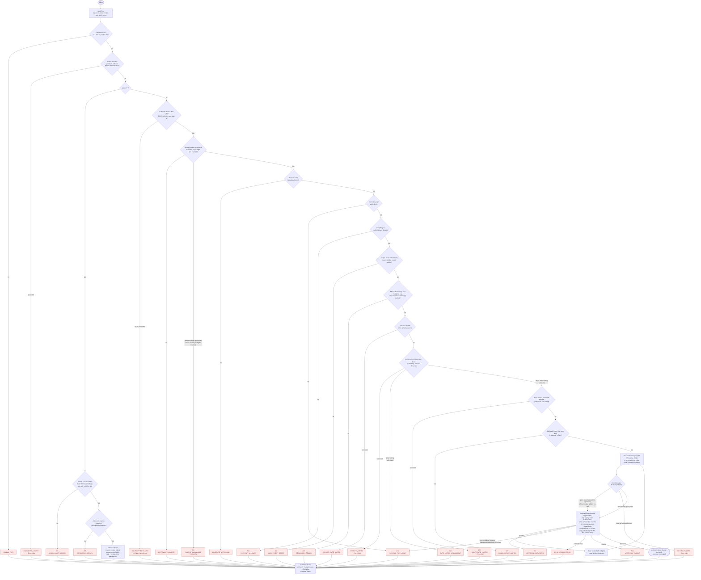
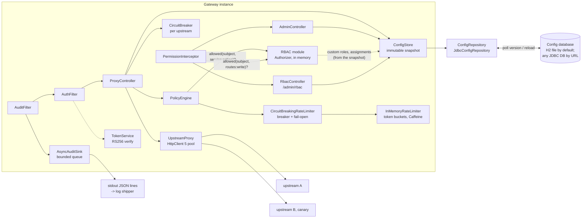
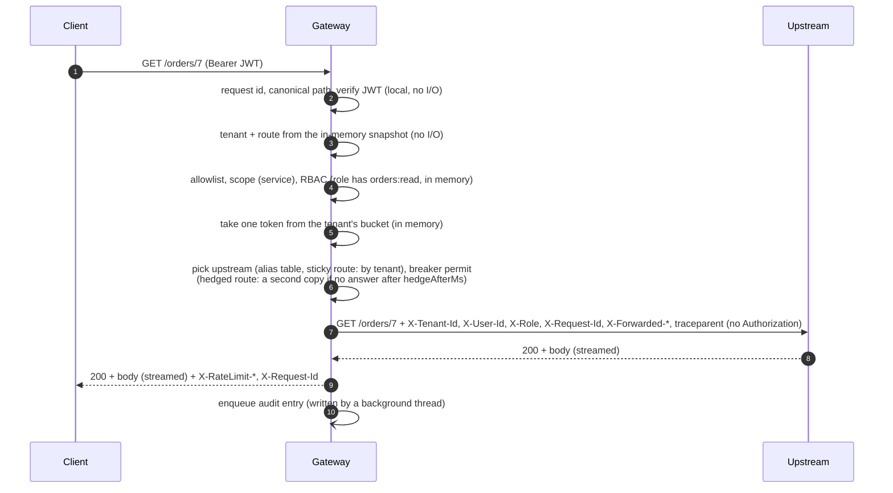
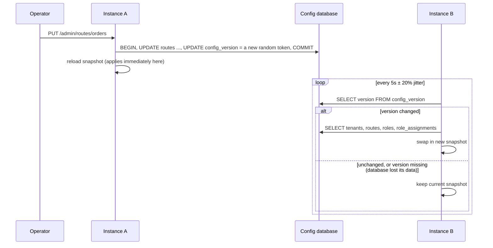

# Architecture

## Request flow (with every failure branch)

Two rules make this diagram true by construction:

* **Reject = throw.** Every stage either passes or throws a `GatewayException`. The outermost filter
  (or the controller advice) renders it as `application/problem+json`. A rejected request therefore
  cannot reach the proxy code.
* **One audit entry per request**, written in `AuditFilter`'s `finally`. Stages only fill in fields
  of the request's `AuditRecord`.

The order is deliberate: local, cheap checks first; the size check before anything that spends quota;
the quota check (which also *consumes* quota) last among the policies; the circuit breaker
immediately before the upstream call.

## Components

| State | Where | Shared across instances? |
|---|---|---|
| Routes, custom roles, tenant users' role assignments | Config database (H2 file by default), served from an in-memory snapshot | With one shared database (Postgres, MySQL): yes, ≤ 5s propagation. The demo's embedded H2 belongs to its one instance |
| Tenants | Config database, loaded on demand into a 5s single-flight cache | Same as above (≤ 5s propagation with a shared database) |
| Rate-limit buckets | Instance memory (Caffeine) | No: each instance counts on its own (N instances = up to N× a tenant's quota; the demo runs one) |
| Circuit breakers, connection pool, audit queue | Instance memory | No (by design: each instance judges its own view of upstream health) |
| Signing key, admin users (key hashes) and roles | Environment / secret manager / application.yml | Same values on every instance |

## Sequence: an allowed request

No per-request I/O before the upstream: routes, RBAC and the quota are in memory; a tenant and a token's
revocation state are each read from the config database once per 5s per instance (single flight, stale
if error), so a cache miss costs one read shared by every concurrent request that needs it.

## Configuration changes at runtime

Two instances only see each other's writes when they share one database (Postgres, MySQL). With the
demo's embedded H2 there is one instance, and the poll just confirms nothing changed.
