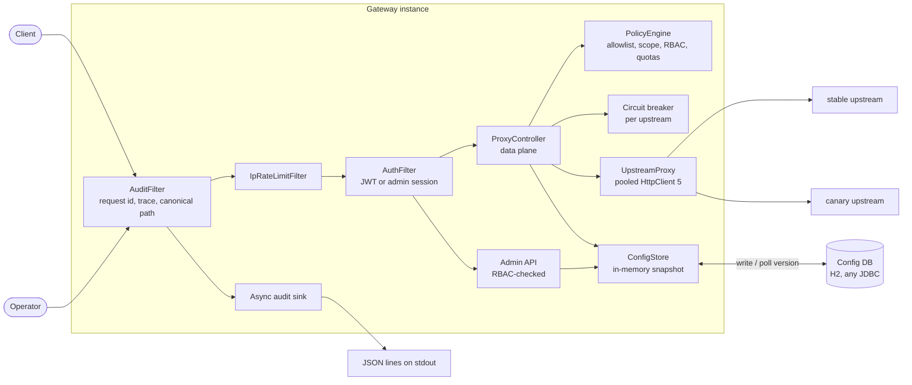
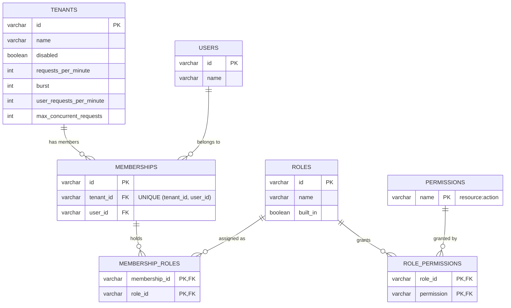
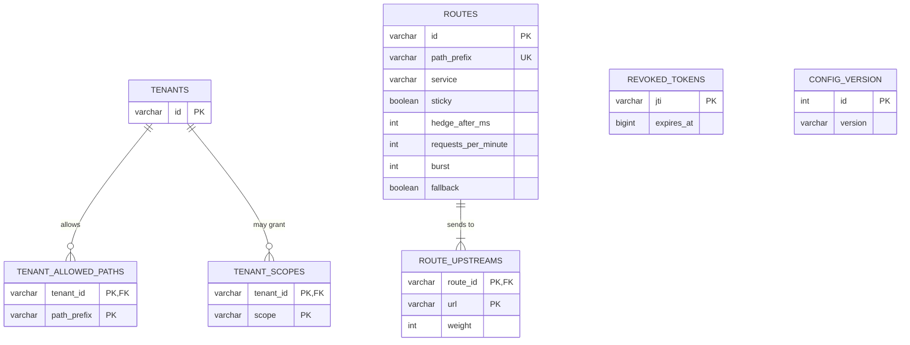
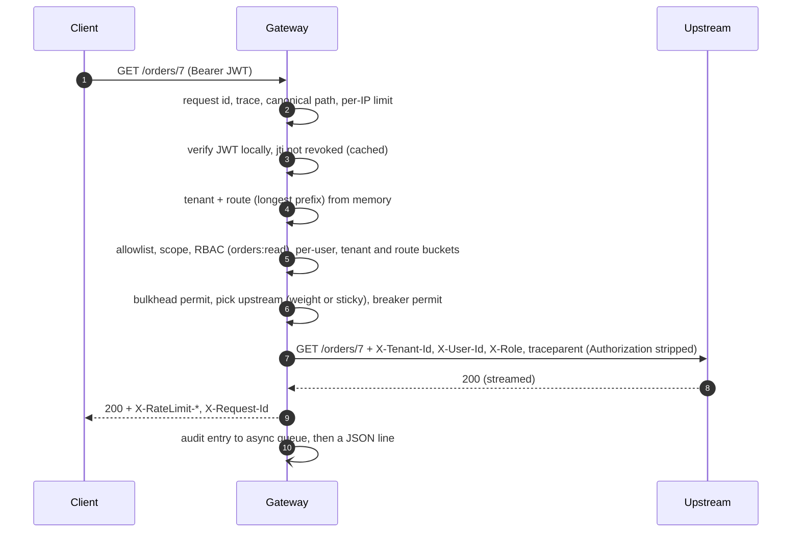
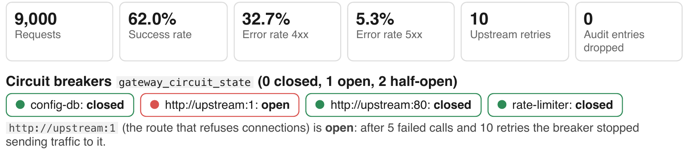
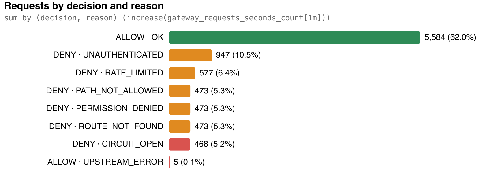
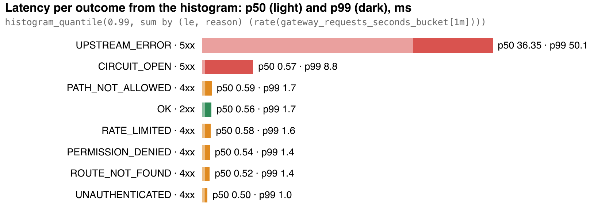

# Multi-tenant API gateway: overview

A gateway that sits in front of internal services and serves many tenants: it authenticates each
request (RS256 JWT), applies the tenant's policy (path allowlist, scopes, RBAC, rate limits,
concurrency), then proxies to a weighted or canary upstream with circuit breakers, retries and
hedging. Every request produces exactly one audit entry.

Java 21, Spring Boot 3.5 (MVC on virtual threads), Apache HttpClient 5, Caffeine, JDBC + H2, Nimbus JOSE.
Live demo: `https://pfx-multi-tenant-gateway-5drq9.ondigitalocean.app/` (DigitalOcean App Platform).

## 1. Architecture



### Features and design considerations

In the order they are usually built, from the core outwards:

| # | Feature | What it does and why |
|---|---|---|
| 1 | Reverse proxy and routing | Runtime route table, longest prefix wins; client `Authorization` and identity headers stripped, the gateway sets its own (`X-Tenant-Id`, `X-User-Id`, `X-Role`) |
| 2 | Virtual threads (Java 21) | One virtual thread per request, like a goroutine in Go: blocking code stays simple (plain blocking I/O to upstreams and the database), yet a thread waiting on a slow upstream costs a few KB instead of a 1 MB platform thread, so concurrency is not capped by a thread pool. Measured: 20,000 requests/s at p99 4.7 ms, and over 10,000 requests in flight on a slow upstream using under 1.6 CPU cores. Locks are `ReentrantLock`, not `synchronized`, so a blocked virtual thread never pins its carrier thread |
| 3 | Authentication | RS256 tenant JWTs verified locally (no I/O); admin login with one active role; token revocation by `jti` |
| 4 | Authorization | Path allowlist and scopes per tenant; RBAC (user → roles → permissions) as one module for both the admin API and the data plane; custom roles cannot escalate |
| 5 | Audit and errors | Exactly one audit entry per request (async queue); every rejection is a thrown exception rendered once as RFC 9457 problem+json |
| 6 | Rate limiting | Token buckets (rate + burst) behind a `RateLimiter` interface: per IP before auth, then per user, per tenant, per route; checked last so rejected requests spend no quota. Buckets are in each instance's memory; a breaker with fail-open/closed wraps the interface for when a shared store (Redis) replaces it |
| 7 | Configuration store | Tenants, routes and RBAC in a JDBC database (portable SQL, H2 default), served from an immutable in-memory snapshot; instances reload when a version row changes |
| 8 | SingleFlight cache | Tenant and token-revocation lookups are cached for 5 s; when many requests miss the same key at once, only one reads the database and the rest wait for its result. Unknown tenants are cached too, failures are not, and a failed reload keeps serving the last good value |
| 9 | Resilience | Circuit breaker per upstream, with fallback to a healthy upstream of the route (per-route `fallback`, on by default); bulkhead per tenant; retries with full-jitter backoff and a retry budget; hedging for slow idempotent calls, which also spends the retry budget and needs the target's breaker to admit it (the slower call is cancelled). Retries and hedges apply only to GET/HEAD/OPTIONS without a body, so no body is ever buffered for replay |
| 10 | Load-spike protection | Instances poll the config version on a jittered interval (±20%) so they never hit the database together; a breaker around config-database reads fails fast during an outage instead of every cache miss waiting on a timeout; 429 and 503 responses carry `Retry-After` so clients know when to come back |
| 11 | Upstream connection pool | Pooled, reused connections to upstreams (HttpClient 5) with limits per upstream and in total; idle connections are kept long enough to be reused, so heavy traffic does not run out of local ports; a request waits briefly for a free connection, then gets 503 |
| 12 | Observability | `X-Request-Id` on every request (sent upstream, returned to the client, in the audit entry); W3C trace context without a library; Prometheus metrics with bounded tags and SLO burn-rate alerts |
| 13 | Input and SSRF protection | Rejects requests and routes that could trick the gateway: paths that mean something else after decoding (`/orders/../admin`, `%2f`, `;`, control characters) get 400, so the allowlist checks the path the upstream will really see; bodies over 10 MB get 413; a route cannot point at cloud metadata (`169.254.169.254`) or the gateway's own host (loopback) |
| 14 | Traffic management | Weighted canary (Vose alias, O(1)); sticky canary per tenant (rendezvous hashing) |
| 15 | Performance | Load-test kit and two stress tests (section 5) |
| 16 | Delivery | Docker demo, a real Go upstream (stable and canary), DigitalOcean App Platform deployment |

## 2. Data model

**Target schema.** The normalised design below; section 2.1 shows what the code implements today.
The configuration database is the source of truth, and every instance serves it from an in-memory
snapshot.

**Tenants, users and RBAC**



**Tenant policy, routes and housekeeping**



**RBAC:** users are global and join tenants through `memberships`; roles are held per membership,
so one user can be an admin in one tenant and a reader in another. Roles and permissions are one
catalogue shared by all tenants, defined by the platform. A token is issued for one membership and one
role: the user must be a member of the tenant and hold the role there. Operators, who manage the gateway itself, belong to no
tenant; they and their roles are configured outside these tables.

| Table | Notes |
|---|---|
| `tenants` | Quotas and the bulkhead size; deleting a tenant cascades to its memberships, their roles, paths and scopes |
| `users` | One row per person or service account, independent of tenants |
| `memberships` | Which tenants a user belongs to; one row per (tenant, user), enforced by a unique constraint |
| `membership_roles` | A user's roles within one tenant, keyed by `membership_id`; deleting a membership deletes its roles |
| `roles` | Shared by all tenants: built-in ones, plus custom ones operators add (service permissions only, so they cannot escalate) |
| `permissions`, `role_permissions` | A permission is `resource:action`, e.g. `orders:read`; a role is a set of them |
| `tenant_allowed_paths`, `tenant_scopes` | Paths the tenant may call; services its tokens may name |
| `routes`, `route_upstreams` | `path_prefix` unique, longest match wins; `weight` 1–1000 drives the canary split |
| `revoked_tokens` | Revoked token ids, kept until the token would have expired anyway |
| `config_version` | One row; a new UUID in the same transaction as every write tells other instances to reload |

### 2.1 Implemented schema (`schema-h2.sql`)

| Table | Columns | Holds |
|---|---|---|
| `tenants` | `id` PK, `data` text | the tenant as JSON (quotas, allowed paths, scopes) |
| `routes` | `id` PK, `path_prefix` UNIQUE, `data` text | the route as JSON (upstreams and weights, service, sticky, hedging, limits, fallback) |
| `roles` | `name` PK, `permissions` text | custom roles only (built-in roles are in `application.yml`) |
| `role_assignments` | `tenant_id` + `user_id` PK, `roles` text; FK → `tenants` ON DELETE CASCADE | a tenant user's roles (membership and roles in one row) |
| `revoked_tokens` | `jti` PK, `expires_at` | as in the target schema |
| `config_version` | `id` PK, `version` | as in the target schema |

Why simpler: lists are stored as the admin API's JSON in one text column, so the same SQL (no vendor
upserts, no JSON column types) runs unchanged on H2, Postgres and MySQL, and a record is read and written
whole. The cost: no foreign keys or indexes inside the lists, and no global `users` table (a user id is
only meaningful within its tenant). The admin API bodies:

```json
// PUT /admin/tenants/acme
{
  "id": "acme", "name": "Acme", "disabled": false,
  "requestsPerMinute": 600, "burst": 100,
  "userRequestsPerMinute": 120, "maxConcurrentRequests": 50,
  "allowedPathPrefixes": ["/orders"],
  "grantableScopes": ["orders"]
}

// PUT /admin/routes/orders
{
  "id": "orders", "pathPrefix": "/orders", "service": "orders",
  "sticky": false, "hedgeAfterMs": 0, "requestsPerMinute": 0, "burst": 0, "fallback": true,
  "upstreams": [
    { "url": "http://stable:8080", "weight": 90 },
    { "url": "http://canary:8080", "weight": 10 }
  ]
}
```

Not in the database: tenant tokens (RS256 JWT with `tid`, `sub`, `role`, `scope`, `jti`), operators
and built-in roles (`application.yml`), rate-limit buckets and breakers (instance memory).

## 3. Data flow

### An allowed request



### Where a request can stop

| Stage | Rejection |
|---|---|
| Path canonicalisation | 400 `BAD_PATH` |
| Per-IP limit (before auth) | 429 `IP_RATE_LIMITED` |
| JWT / admin session | 401 `UNAUTHENTICATED` / `ADMIN_UNAUTHORIZED` |
| Tenant disabled, route missing, body too large | 403 / 404 / 413 |
| Allowlist, scope, RBAC | 403 `PATH_NOT_ALLOWED` / `INSUFFICIENT_SCOPE` / `PERMISSION_DENIED` |
| User, tenant, route quota; bulkhead | 429 `USER_RATE_LIMITED` / `RATE_LIMITED` / `ROUTE_RATE_LIMITED` / `CONCURRENCY_LIMITED` |
| All breakers open, pool full | 503 `CIRCUIT_OPEN` / `UPSTREAM_SATURATED` |
| Upstream connect error / timeout | 502 / 504 (idempotent requests retried within a retry budget) |

**Resilience:** if the picked upstream's breaker is open, the gateway falls back to another upstream on
the route (this is what the canary demo shows); a route with `"fallback": false` answers 503 instead,
trading availability for never putting a canary under full load; a hedged route sends a second copy after
`hedgeAfterMs` and takes the first answer.

### Three authorization layers

Each layer answers a different question, so a mistake in one is not enough to reach a service:

- **Path allowlist** (per tenant): which paths this tenant may call at all.
- **Scopes** (in the token, within what the tenant may grant): which services this token may name.
- **RBAC** (role → permissions): which actions (`orders:read`, `orders:delete`, by HTTP method) the
  token's role may perform. On every request the gateway also checks that the user still holds that
  role (from the in-memory snapshot), so removing a role takes effect at the next config reload, not at
  token expiry.

### A config change

`PUT /admin/routes/{id}` writes the data and a new `config_version` in one transaction, and the
instance reloads its snapshot at once. Other instances poll the version every 5 s (±20% jitter) and
swap in a new snapshot when it changes; if the version row is missing they keep the old one.

## 4. Audit log samples

One JSON line per request, written off the request path. These are picked from the 9,007 lines of the
mixed run in section 6, one per outcome (tenant `mix-a`, user `rita`, role `orders-reader`):

| Request | Status | `reason` | `detail` / upstream | ms |
|---|---|---|---|---|
| `GET /mix/items/2` | 200 | – | `http://upstream:80`, 1 upstream span | 2.30 |
| `GET /mix/items/1`, no token | 401 | `UNAUTHENTICATED` | `auth:MISSING_TOKEN` | 1.71 |
| `GET /mix/items/1`, forged token | 401 | `UNAUTHENTICATED` | `auth:INVALID_SIGNATURE` | 0.52 |
| `GET /bill/1` | 403 | `PATH_NOT_ALLOWED` | – | 5.01 |
| `DELETE /mix/items/1` (a reader) | 403 | `PERMISSION_DENIED` | – | 0.94 |
| `GET /nope/1` | 404 | `ROUTE_NOT_FOUND` | – | 0.93 |
| `GET /mix/items/12` | 429 | `RATE_LIMITED` | – | 1.34 |
| `GET /dead/1` | 502 | `UPSTREAM_ERROR` | `HttpHostConnectException`; `http://upstream:1`, 2 upstream spans (call + retry) | 9.90 |
| `GET /dead/1` | 503 | `CIRCUIT_OPEN` | `retried after UPSTREAM_ERROR from http://upstream:1`; 1 upstream span | 26.32 |
| `GET /dead/1` | 503 | `CIRCUIT_OPEN` | – (no upstream call) | 0.76 |

The last three rows show the breaker at work. A refused connection is retried once (two upstream spans)
and fails with 502. Once the breaker is open, requests to the dead upstream are refused in under 1 ms
without touching it. When a call fails just as the breaker opens again, its retry is refused by the
breaker (the 26 ms include the retry's backoff). The two 401s also
show what the metrics cannot: the same `UNAUTHENTICATED` reason, but `detail` says why.

The full line for the retried request:

```json
{"requestId": "f999189d-65bf-40fa-b0df-6d47024cfeb5",
 "traceId": "c43299916e2af3188e76484c3fe88983", "spanId": "95da5e8378768840",
 "tenantId": "mix-a", "actor": "rita", "role": "orders-reader", "clientIp": "172.64.144.78",
 "method": "GET", "path": "/dead/1", "routeId": "dead", "upstream": "http://upstream:1",
 "decision": "DENY", "reason": "CIRCUIT_OPEN",
 "detail": "retried after UPSTREAM_ERROR from http://upstream:1", "upstreamStatus": null,
 "upstreamSpans": ["7e6a1901083530c5"], "status": 503, "latencyMs": 26.315083}
```

## 5. Load test

From [loadtest-results/REPORT.md](../loadtest-results/REPORT.md). Two tests on one laptop (Apple M4 Max,
Docker Desktop VM with 16 CPUs and 8 GB), both with vegeta (constant arrival rate) against the gateway
at step 32:

| | Test 1: upstream answers at once | Test 2: upstream answers in 100 ms – 5 s (uniform, mean 2.55 s) |
|---|---|---|
| What limits throughput | CPU per request (~0.3 ms) | Requests in flight: rate × 2.55 s (Little's law) |
| With the default settings | **4,000 requests/s** (pool per upstream, breaker window, client ports) | **20 requests/s** (pool of 100 per upstream) |
| Best measured | **20,000 requests/s**, p99 4.7 ms, 100% (highest tried) | **5,000 requests/s** (~12,800 in flight), p99 4.95 s = the upstream's own, 100% |
| What it took | pool 400 per upstream; client capped at 2,000 connections | pool 20,000; Tomcat `max-connections` 20,000; load generated inside the Docker network |
| What stopped it next | not reached | memory: ~145 KB live per request in flight, mostly Tomcat and HttpClient buffers, on a VM already near its 8 GB |
| Code changed | no | no (configuration only; two GC alternatives were tried and were worse) |

Notes on the table:

- **Test 1, "breaker window":** the breaker judges the last 20 calls. At 8,000 requests/s that is about
  2.5 ms of traffic, so a short burst of pool timeouts opened the breaker for 10 s on a healthy upstream,
  and most failed requests got 503 `CIRCUIT_OPEN`. A time-based window would judge on more evidence.
- **Test 2, "20 requests/s":** Little's law gives 100 connections ÷ 2.55 s ≈ 39 requests/s. The run
  tested only 20 and 40 requests/s: 20 passed, and 40 needed about 102 connections and failed. So 20 is
  the highest rate that passed, and the limit lies between 20 and 39.
- **Next optimisation:** most of the ~145 KB per request in flight is Tomcat and HttpClient I/O buffers;
  smaller buffers could cut it, at the cost of more system calls for large bodies. Not measured yet.
- **Limits:** the load generator, the gateway and the upstream shared one laptop, with no real network
  latency between them, so the numbers are a lower bound and not a capacity plan.

## 6. Metrics from a mixed run

Scraped from the gateway's Prometheus endpoint (`/actuator/prometheus`) after a 60 s mixed run at
150 requests/s: allowed requests, every common rejection, and one route whose upstream refuses
connections. Load-test and admin calls are excluded. Each chart shows the PromQL that would draw it
in Grafana.







Every rejection costs about 0.5 ms at p50, the same as a served request, because each check runs in
memory before any upstream call. `CIRCUIT_OPEN` fails fast too: the open breaker answers without
touching the dead upstream.

**Metrics vs audit log**

| Question | Prometheus metric | Audit log |
|---|---|---|
| Success / failure rate, trends, alerts | ✅ cheap, aggregated over all instances | possible, but needs a log search |
| Exact status code (401 vs 403) | status class only (`4xx`), plus `reason` | ✅ exact `status` |
| Why auth failed (missing token vs bad signature) | ❌ only `UNAUTHENTICATED` | ✅ `detail: auth:MISSING_TOKEN` |
| Which tenant / user / path | ❌ never a label (unbounded cardinality) | ✅ `tenantId`, `actor`, `path`, `requestId` |

Labels are deliberately bounded (`decision`, `reason`, `route`, `status` class): the metric says *how
many and how fast*, the audit log says *who and exactly why*.

## 7. Deployment topology

The live demo on DigitalOcean App Platform runs **one gateway instance** with the embedded H2 database
inside its container, plus internal `stable` and `canary` upstreams. H2 is per instance and is reset on
every deploy, so config propagation across instances (version polling) is covered by integration tests
but **not exercised in the live demo**. Running more instances needs a shared database (Postgres or
MySQL, by URL) and, for exact quotas, a shared rate limiter.

## 8. Known gaps and next steps

| Gap | Effect | Next step |
|---|---|---|
| Rate limits and bulkhead are per instance | With N instances a tenant gets up to N × its quota and N × its concurrent requests | A Redis implementation of `RateLimiter` (atomic check-and-consume in Lua, keys hash-tagged per tenant, fail-open/closed by setting) |
| Client address behind App Platform's edge | `gateway.trusted-proxies` is empty there, so the per-IP limit sees the edge's addresses: one busy machine can hit 429 above about 20 requests/s | Set `trusted-proxies` to the edge's address ranges (TODO: verify which ranges App Platform uses) |
| Token revocation is cached and fails open | A revoked token can work for up to 5 s on another instance; while the config database is down, a token never checked on an instance is served | `gateway.revocation-fail-open: false` rejects with 503 instead; revocations could be pushed into the snapshot |
| Breaker fallback can move all traffic to the canary | With stable's breaker open, a 90/10 route sends everything to the canary, and sticky tenants switch version | Per route, `"fallback": false` answers 503 instead (availability vs. exposing an unvalidated version) |
| DNS rebinding | An upstream host is checked when the route is saved, not when the gateway connects; a name that later resolves to a blocked address is not caught | Check the resolved address at connect time (a custom DNS resolver in the connection pool) |
| No overall request deadline | Retries are bounded by attempts (2) and timeouts (2 s connect, 10 s response), not by a total budget | A per-request deadline that stops retrying when too little time is left |
| Config database in the container | Tenants and routes are lost on every redeploy of the demo | A managed Postgres

## 9. Security assumptions

The gateway treats every client, including a tenant with a valid token, as untrusted.
It relies on the following; the right column says what breaks if one does not hold.

| Assumption | If it does not hold |
|---|---|
| **Upstreams are reachable only through the gateway**, so they can trust `X-Tenant-Id`, `X-User-Id` and `X-Role` | A direct caller could claim any tenant or role |
| **Upstreams ignore method overrides** (`_method` in a form or query) | A reader could turn a `POST` into a delete; the gateway strips override headers but not parameters |
| **TLS ends at the edge** (App Platform's load balancer) | Tokens and admin sessions could be read in transit |
| **The signing key stays secret** (secret env var, never in the repo) | Anyone holding it can mint a token for any tenant |

Also assumed: the config database is on a private network and written only by the
gateway; operators are trusted within their role; clocks are roughly in sync.
