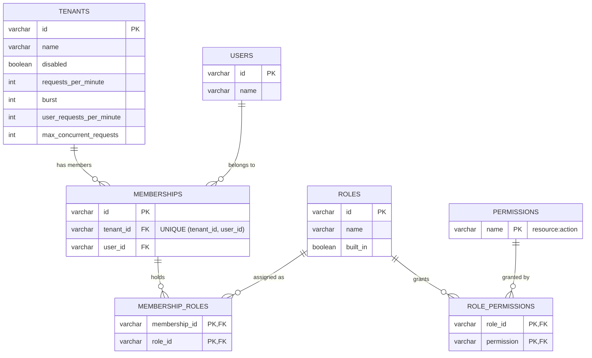
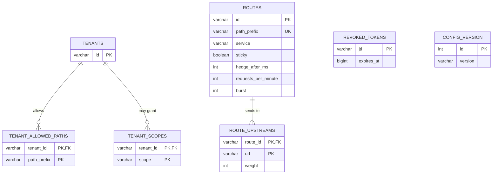
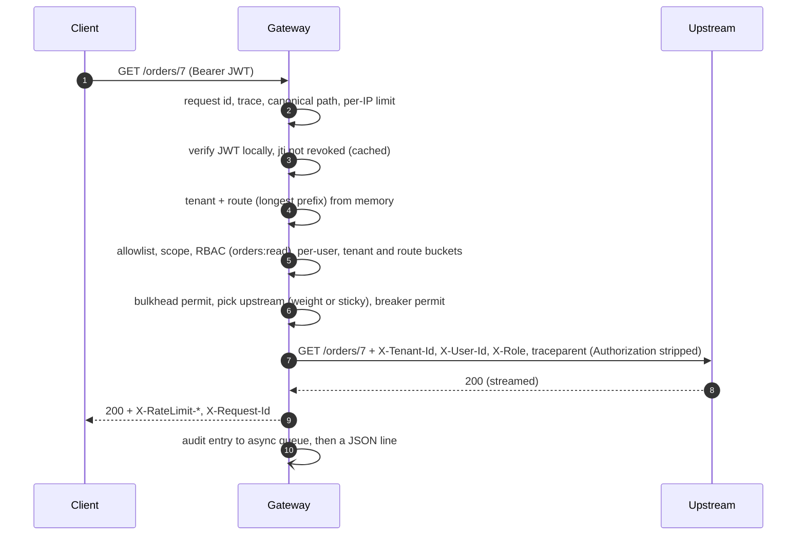

# Multi-tenant API gateway: overview

A gateway that sits in front of internal services and serves many tenants: it authenticates each
request (RS256 JWT), applies the tenant's policy (path allowlist, scopes, RBAC, rate limits,
concurrency), then proxies to a weighted or canary upstream with circuit breakers, retries and
hedging. Every request produces exactly one audit entry.

Java 21, Spring Boot 3.5 (MVC on virtual threads), Apache HttpClient 5, Caffeine, JDBC + H2, Nimbus JOSE.
Live demo: `https://pfx-multi-tenant-gateway-5drq9.ondigitalocean.app/` (DigitalOcean App Platform).

## 1. Architecture


### Features and design considerations

In the order they are usually built, from the core outwards:

| # | Feature | What it does and why |
|---|---|---|
| 1 | Reverse proxy and routing | Runtime route table, longest prefix wins; client `Authorization` and identity headers stripped, the gateway sets its own (`X-Tenant-Id`, `X-User-Id`, `X-Role`) |
| 2 | Virtual threads (Java 21) | One virtual thread per request, like a goroutine in Go: blocking code stays simple (plain blocking I/O to upstreams and the database), yet a thread waiting on a slow upstream costs a few KB instead of a 1 MB platform thread, so concurrency is not capped by a thread pool. Measured: 20,000 requests/s at p99 4.7 ms, and over 10,000 requests in flight on a slow upstream using under 1.6 CPU cores. Locks are `ReentrantLock`, not `synchronized`, so a blocked virtual thread never pins its carrier thread |
| 3 | Authentication | RS256 tenant JWTs verified locally (no I/O); admin login with one active role; token revocation by `jti` |
| 4 | Authorization | Path allowlist and scopes per tenant; RBAC (user → roles → permissions) as one module for both the admin API and the data plane; custom roles cannot escalate |
| 5 | Audit and errors | Exactly one audit entry per request (async queue); every rejection is a thrown exception rendered once as RFC 9457 problem+json |
| 6 | Rate limiting | Token buckets (rate + burst) behind a `RateLimiter` interface: per IP before auth, then per user, per tenant, per route; checked last so rejected requests spend no quota |
| 7 | Configuration store | Tenants, routes and RBAC in a JDBC database (portable SQL, H2 default), served from an immutable in-memory snapshot; instances reload when a version row changes |
| 8 | SingleFlight cache | Tenant and token-revocation lookups are cached for 5 s; when many requests miss the same key at once, only one reads the database and the rest wait for its result. Unknown tenants are cached too, failures are not, and a failed reload keeps serving the last good value |
| 9 | Resilience | Circuit breaker per upstream with fallback to a healthy one; bulkhead per tenant; retries with full-jitter backoff and a retry budget; hedging for slow idempotent calls, which also spends the retry budget and needs the target's breaker to admit it (the slower call is cancelled); fail-open limiter |
| 10 | Load-spike protection | Instances poll the config version on a jittered interval (±20%) so they never hit the database together; a breaker around config-database reads fails fast during an outage instead of every cache miss waiting on a timeout; 429 and 503 responses carry `Retry-After` so clients know when to come back |
| 11 | Upstream connection pool | Pooled, reused connections to upstreams (HttpClient 5) with limits per upstream and in total; idle connections are kept long enough to be reused, so heavy traffic does not run out of local ports; a request waits briefly for a free connection, then gets 503 |
| 12 | Observability | `X-Request-Id` on every request (sent upstream, returned to the client, in the audit entry); W3C trace context without a library; Prometheus metrics with bounded tags and SLO burn-rate alerts |
| 13 | Input and SSRF protection | Rejects requests and routes that could trick the gateway: paths that mean something else after decoding (`/orders/../admin`, `%2f`, `;`, control characters) get 400, so the allowlist checks the path the upstream will really see; bodies over 10 MB get 413; a route cannot point at cloud metadata (`169.254.169.254`) or the gateway's own host (loopback) |
| 14 | Traffic management | Weighted canary (Vose alias, O(1)); sticky canary per tenant (rendezvous hashing) |
| 15 | Performance | Load-test kit and two stress tests (section 4) |
| 16 | Delivery | Docker demo, a real Go upstream (stable and canary), DigitalOcean App Platform deployment |

## 2. Data model

Relational schema of the configuration database (the source of truth; every instance serves it from
an in-memory snapshot):

**Tenants, users and RBAC**



**Tenant policy, routes and housekeeping**



**RBAC:** users are global and join tenants through `memberships`; roles are held per membership,
so one user can be an admin in one tenant and a reader in another. Roles and permissions are one
catalogue shared by all tenants, defined by the platform. A token is issued for one membership and one
role: the user must be a member of the tenant and hold the role there. Operators, who manage the gateway itself, belong to no
tenant; they and their roles are configured outside these tables.

| Table | Notes |
|---|---|
| `tenants` | Quotas and the bulkhead size; deleting a tenant cascades to its memberships, their roles, paths and scopes |
| `users` | One row per person or service account, independent of tenants |
| `memberships` | Which tenants a user belongs to; one row per (tenant, user), enforced by a unique constraint |
| `membership_roles` | A user's roles within one tenant, keyed by `membership_id`; deleting a membership deletes its roles |
| `roles` | Shared by all tenants: built-in ones, plus custom ones operators add (service permissions only, so they cannot escalate) |
| `permissions`, `role_permissions` | A permission is `resource:action`, e.g. `orders:read`; a role is a set of them |
| `tenant_allowed_paths`, `tenant_scopes` | Paths the tenant may call; services its tokens may name |
| `routes`, `route_upstreams` | `path_prefix` unique, longest match wins; `weight` 1–1000 drives the canary split |
| `revoked_tokens` | Revoked token ids, kept until the token would have expired anyway |
| `config_version` | One row; a new UUID in the same transaction as every write tells other instances to reload |

The current code (`schema-h2.sql`) implements a simpler form: lists are stored in one text column as
the admin API's JSON (portable across H2, Postgres and MySQL); memberships and their roles are one
table, `role_assignments` (tenant, user → roles), with no separate `users` table. The admin API bodies:

```json
// PUT /admin/tenants/acme
{
  "id": "acme", "name": "Acme", "disabled": false,
  "requestsPerMinute": 600, "burst": 100,
  "userRequestsPerMinute": 120, "maxConcurrentRequests": 50,
  "allowedPathPrefixes": ["/orders"],
  "grantableScopes": ["orders"]
}

// PUT /admin/routes/orders
{
  "id": "orders", "pathPrefix": "/orders", "service": "orders",
  "sticky": false, "hedgeAfterMs": 0, "requestsPerMinute": 0, "burst": 0,
  "upstreams": [
    { "url": "http://stable:8080", "weight": 90 },
    { "url": "http://canary:8080", "weight": 10 }
  ]
}
```

Not in the database: tenant tokens (RS256 JWT with `tid`, `sub`, `role`, `scope`, `jti`), operators
and built-in roles (`application.yml`), rate-limit buckets and breakers (instance memory).

## 3. Data flow

### An allowed request



### Where a request can stop

| Stage | Rejection |
|---|---|
| Path canonicalisation | 400 `BAD_PATH` |
| Per-IP limit (before auth) | 429 `IP_RATE_LIMITED` |
| JWT / admin session | 401 `UNAUTHENTICATED` / `ADMIN_UNAUTHORIZED` |
| Tenant disabled, route missing, body too large | 403 / 404 / 413 |
| Allowlist, scope, RBAC | 403 `PATH_NOT_ALLOWED` / `INSUFFICIENT_SCOPE` / `PERMISSION_DENIED` |
| User, tenant, route quota; bulkhead | 429 `USER_RATE_LIMITED` / `RATE_LIMITED` / `ROUTE_RATE_LIMITED` / `CONCURRENCY_LIMITED` |
| All breakers open, pool full | 503 `CIRCUIT_OPEN` / `UPSTREAM_SATURATED` |
| Upstream connect error / timeout | 502 / 504 (idempotent requests retried within a retry budget) |

**Resilience:** if the picked upstream's breaker is open, the gateway falls back to another upstream on
the route (this is what the canary demo shows); a hedged route sends a second copy after
`hedgeAfterMs` and takes the first answer.

### A config change

`PUT /admin/routes/{id}` writes the data and a new `config_version` in one transaction, and the
instance reloads its snapshot at once. Other instances poll the version every 5 s (±20% jitter) and
swap in a new snapshot when it changes; if the version row is missing they keep the old one.

## 4. Load test

From [loadtest-results/REPORT.md](../loadtest-results/REPORT.md). Two tests on one laptop (Apple M4 Max,
Docker Desktop VM with 16 CPUs and 8 GB), both with vegeta (constant arrival rate) against the gateway
at step 32:

| | Test 1: upstream answers at once | Test 2: upstream answers in 100 ms – 5 s (uniform, mean 2.55 s) |
|---|---|---|
| What limits throughput | CPU per request (~0.3 ms) | Requests in flight: rate × 2.55 s (Little's law) |
| With the default settings | **4,000 requests/s** (pool per upstream, breaker window, client ports) | **20 requests/s** (pool of 100 per upstream) |
| Best measured | **20,000 requests/s**, p99 4.7 ms, 100% (highest tried) | **5,000 requests/s** (~12,800 in flight), p99 4.95 s = the upstream's own, 100% |
| What it took | pool 400 per upstream; client capped at 2,000 connections | pool 20,000; Tomcat `max-connections` 20,000; load generated inside the Docker network |
| What stopped it next | not reached | memory: ~145 KB live per request in flight, mostly Tomcat and HttpClient buffers, on a VM already near its 8 GB |
| Code changed | no | no (configuration only; two GC alternatives were tried and were worse) |
